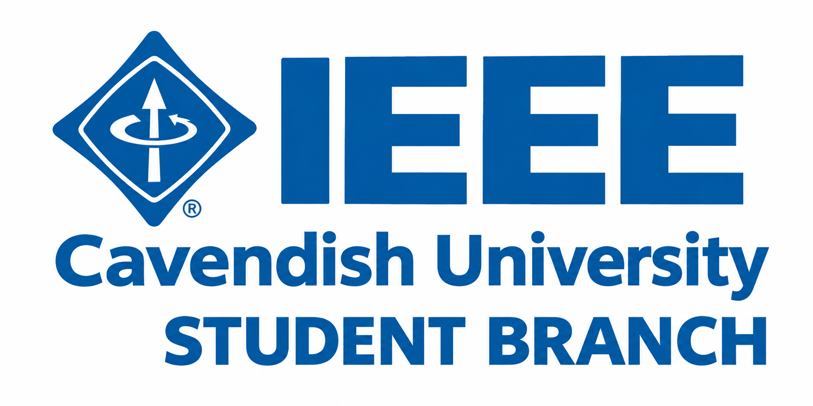
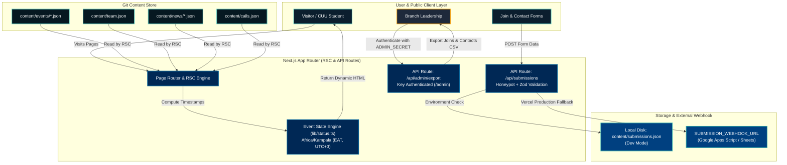
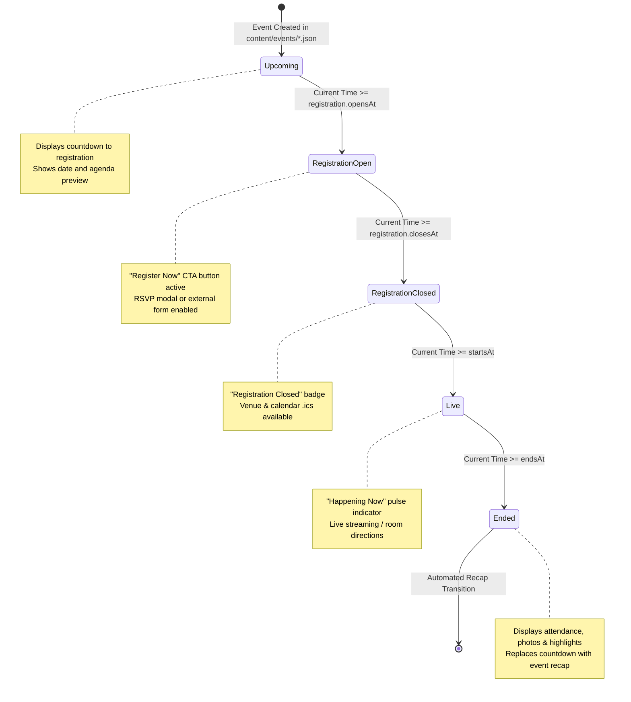
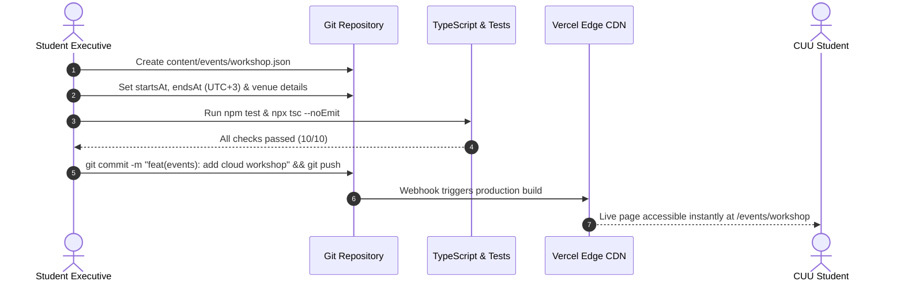

<p align="center">
  <a href="https://ieee-cuu-website.vercel.app/" target="_blank" rel="noopener noreferrer">
    
  </a>
</p>

<h1 align="center">IEEE Student Branch — Cavendish University Uganda</h1>

<p align="center">
  <strong>The official web platform and community portal for the IEEE Student Branch at Cavendish University Uganda (CUU).</strong><br>
  Operating under the <strong>IEEE Uganda Section</strong> and <strong>IEEE Region 8</strong> (Europe, Middle East, and Africa).
</p>

<p align="center">
  <a href="https://ieee-cuu-website.vercel.app/"></a>
  <a href="https://nextjs.org/"></a>
  <a href="https://www.typescriptlang.org/"></a>
  <a href="https://tailwindcss.com/"></a>
  <a href="https://zod.dev/"></a>
  
</p>

<p align="center">
  <a href="#-overview">Overview</a> •
  <a href="#-tech-stack--architecture">Tech Stack</a> •
  <a href="#-system-architecture--workflows">System Workflows</a> •
  <a href="#-installation-mode--local-setup">Installation Mode</a> •
  <a href="#-student-handover-guide">Student Handover</a> •
  <a href="#-branch-administration--exports">Admin & Exports</a> •
  <a href="#-handover-checklist">Handover Checklist</a>
</p>

---

##  Overview

The **IEEE Student Branch at Cavendish University Uganda (CUU)** is the premier student-led technical and professional society at Cavendish University Uganda, based at the **Siyani Campus** (Plot 1469 Ggaba Road, Kampala). As an affiliated unit of the **IEEE Uganda Section** and **IEEE Region 8**, the branch bridges the gap between academic theory, technological innovation, and engineering leadership across East Africa.

This repository powers the official, production-grade web portal deployed at [ieee-cuu-website.vercel.app](https://ieee-cuu-website.vercel.app/). It was custom-engineered from the ground up to solve recurring challenges in university branch websites: stale dates, broken links, bloated client-side bundles, unmaintained databases, and difficult handovers between graduating student committees.

### Key Pillars & Core Capabilities

-  **Zero Stale State & Deterministic Event Engine**: All events and recruitment calls follow an automated time-state machine calculated in the **Africa/Kampala (EAT, UTC+3)** timezone. The site never displays expired countdowns or broken registration buttons. Statuses dynamically shift from `upcoming` &rarr; `registration-open` &rarr; `registration-closed` &rarr; `live` &rarr; `ended` (with recap blocks) on the server.
-  **Dual Student Society Integration**: Unifies the IEEE Student Branch and **CUUCSA** (Cavendish University Uganda Computing Students' Association) under a shared digital roof while preserving brand governance and independence.
-  **Designed for Ugandan Mobile Networks**: Engineered mobile-first with minimal JavaScript, responsive typography, zero Cumulative Layout Shift (CLS), and high performance on 3G/4G connections.
-  **Privacy-First & Strict Brand Integrity**: Adheres strictly to IEEE brand guidelines. Profiles, photos, and links are only rendered if verifiable written or electronic consent (`consent: true`) is recorded.
-  **Zero-Database Content Architecture**: The entire website runs on decoupled, version-controlled JSON files in `content/`. Incoming executive committees can update events, news, team members, and calls in minutes without touching a single component or database query.
-  **Built-in Spam Protection & Fail-Safe Ingestion**: Form submissions (Join and Contact) feature anti-bot honeypot fields, IP-based rate limiting, dual-layer Zod validation, local JSON fallback storage, and serverless webhook pipelines (e.g., Google Apps Script to Google Sheets).
-  **Protected Executive Administration**: Integrated `/admin` dashboard protected by `ADMIN_SECRET` authentication, enabling one-click CSV data exports for branch leadership.

---

##  Tech Stack & Architecture

The application is built on modern, resilient web technologies selected for speed, strict type safety, zero database maintenance overhead, and long-term sustainability:

### Core Technologies

| Category | Technology | Version | Rationale & Usage in Repo |
|---|---|---|---|
| **Framework** | [Next.js](https://nextjs.org/) | `14.2` | App Router with React Server Components (RSC) for instantaneous server-side status resolution, static generation, and automated ISR revalidation. |
| **Language** | [TypeScript](https://www.typescriptlang.org/) | `5.5` | Strict type checking throughout components, schemas, content loaders, and server actions. Prevents runtime anomalies. |
| **Styling** | [Tailwind CSS](https://tailwindcss.com/) | `3.4` | Customized design system matching official IEEE brand guidelines: Deep Navy (`#0B1E2E`, `#061821`), IEEE Cyan/Teal (`#5fd0c6`), and IEEE Blue (`#00629B`). |
| **Schema Validation** | [Zod](https://zod.dev/) | `3.23` / `4.x` | Runtime schema validation for form submissions, content integrity, honeypot detection, and route parameters. |
| **Icons & Visuals** | [Lucide React](https://lucide.dev/) | `^0.446` | Accessible, tree-shakable SVG icon suite for interactive UI states and navigation. |
| **Content Store** | Decoupled JSON | Standard | File-based data architecture in `content/` ensuring zero hosting database costs and complete Git revision tracking. |
| **Testing Engine** | Node.js Test Runner | `node:test` | Native zero-dependency unit test suite (`tests/status.test.ts`) validating time-zone state shifts, countdown logic, and registration windows. |
| **Deployment** | [Vercel](https://vercel.com/) | Edge/Serverless | Global CDN distribution, automated branch preview deployments, and serverless API execution. |

### Architectural Highlights

- **Server-Rendered Status Engine (`lib/status.ts`)**: Server components calculate the current phase of every event and call before transmitting HTML to the browser. This eliminates hydration mismatches, client-side flashes of `00:00:00`, and layout shifts.
- **Resilient Dual Ingestion Pipeline (`lib/submissions.ts`)**:
  - In local development: appends verified entries directly to `content/submissions.json`.
  - In production on Vercel (read-only filesystem): relays payloads via an encrypted POST request to `SUBMISSION_WEBHOOK_URL` (Google Apps Script / Google Sheets), ensuring zero data loss.

---

##  System Architecture & Workflows

### 1. Overall System Data Flow



---

### 2. Event Lifecycle & Time-State Engine

Events are automatically evaluated against the current wall-clock time in **Kampala (UTC+3)**:



---

### 3. Student Contributor Workflow



---

##  Installation Mode & Local Setup

Follow this comprehensive, step-by-step setup guide to run the project on your local machine.

### Prerequisites

Ensure you have the following installed on your system:
- **Node.js**: `v18.17.0+` or `v20.0.0+` (LTS recommended)
- **Package Manager**: `npm v9+` (included with Node), or `pnpm` / `yarn`
- **Git**: Version `2.30+`

---

### Step 1: Clone the Repository

```bash
# Clone the repository via HTTPS or SSH
git clone https://github.com/EGABO-TECH/ieee-cuu-website.git

# Navigate into the project directory
cd ieee-cuu-website
```

---

### Step 2: Install Dependencies

```bash
npm install
```

---

### Step 3: Configure Environment Variables

The project includes a documented template for environment variables. Create a local environment file:

```bash
# On Linux / macOS / Git Bash
cp .env.example .env.local

# On Windows PowerShell
Copy-Item .env.example .env.local
```

Open `.env.local` in your editor and configure the parameters:

| Variable | Scope | Required | Description | Example / Default |
|---|:---:|:---:|---|---|
| `NEXT_PUBLIC_CANONICAL_URL` | Client | **Yes** | Site canonical origin URL | `https://ieee-cuu-website.vercel.app` |
| `NEXT_PUBLIC_BRANCH_EMAIL` | Client | Optional | Official student branch email address | `ieee@cavendish.ac.ug` |
| `NEXT_PUBLIC_IEEE_LINKEDIN_URL` | Client | **Yes** | Official branch LinkedIn organization URL | `https://www.linkedin.com/company/ieee-cavendish-university-student-branch/` |
| `NEXT_PUBLIC_IEEE_X_URL` | Client | **Yes** | Official branch X (Twitter) profile URL | `https://x.com/IEEECavendish` |
| `NEXT_PUBLIC_IEEE_TIKTOK_URL` | Client | **Yes** | Official branch TikTok profile URL | `https://www.tiktok.com/@cavendishieee` |
| `NEXT_PUBLIC_IEEE_WHATSAPP_URL` | Client | **Yes** | Branch community WhatsApp invite link | `https://chat.whatsapp.com/D14xEzlcP9bF4JKXnAiMU8` |
| `NEXT_PUBLIC_CUUCSA_LINKEDIN_URL`| Client | **Yes** | CUUCSA LinkedIn organization profile | `https://www.linkedin.com/company/cavendish-university-uganda-computing-students-association/` |
| `NEXT_PUBLIC_CUUCSA_WHATSAPP_URL`| Client | **Yes** | CUUCSA WhatsApp community invite link | `https://chat.whatsapp.com/JRmTgNpDhRSLVOBPoIDj5W` |
| `ADMIN_SECRET` | Server | **Yes** | High-entropy secret key protecting `/admin` and CSV exports | Generate via `python -c "import secrets; print(secrets.token_urlsafe(32))"` |
| `SUBMISSION_WEBHOOK_URL` | Server | **Production** | Webhook URL (e.g. Google Apps Script) to store Join and Contact submissions when deployed on read-only serverless hosts | `https://script.google.com/macros/s/.../exec` |

>  **Security Notice:** Never commit `.env` or `.env.local` to Git. Keep `ADMIN_SECRET` confidential and rotate it each year when a new executive committee takes office.

---

### Step 4: Run the Development Server

```bash
npm run dev
```

Open [http://localhost:3000](http://localhost:3000) in your web browser. The app runs with Hot Module Replacement (Fast Refresh).

---

### Step 5: Quality Assurance & Testing Suite

Always run these quality checks before committing or opening pull requests:

```bash
# 1. Run unit tests for the time-state engine and registration logic
npm test

# 2. Perform strict TypeScript static type checking
npx tsc --noEmit

# 3. Run ESLint across all components and libraries
npm run lint

# 4. Verify production bundle compilation locally
npm run build
```

---

### Step 6: Production Deployment Mode

1. **Deploying on Vercel**:
   - Push your code to your GitHub repository.
   - Import the repository into your Vercel Dashboard.
   - Under **Project Settings &rarr; Environment Variables**, paste all keys from `.env.local`.
   - Set `SUBMISSION_WEBHOOK_URL` to your external storage endpoint (e.g., Google Apps Script) to enable reliable form handling on Vercel's serverless infrastructure.
2. **Custom Domain**:
   - In Vercel, navigate to **Domains** and add `ieee.cavendish.ac.ug`.
   - Request the Cavendish University IT Department to create a CNAME DNS record pointing `ieee` to `cname.vercel-dns.com`.

---

##  Project Structure

```text
ieee-cuu-website/
├── app/                          # Next.js 14 App Router
│   ├── about/                    # About IEEE and CUU Student Branch
│   ├── admin/                    # Secret-protected executive admin dashboard
│   ├── api/                      # Serverless route handlers (/api/submissions, /api/admin/export)
│   ├── branch/                   # Branch history, mission & organizational units
│   ├── contact/                  # Contact form with honeypot & Zod validation
│   ├── cuucsa/                   # Cavendish University Computing Students' Association page
│   ├── events/                   # Dynamic event listings & [slug] detail pages
│   ├── gallery/                  # Visual photo archive with consent verification
│   ├── governance/               # Constitution, bylaws & governance documents
│   ├── join/                     # Official IEEE membership onboarding & application form
│   ├── news/                     # News articles & event recap archive
│   ├── programs/                 # Technical societies, SIGs & student initiatives
│   ├── projects/                 # Student innovation showcase
│   ├── team/                     # Executive committee & counselor directory
│   ├── volunteer/                # Volunteer recruitment calls & application portal
│   ├── layout.tsx                # Root layout, analytics & global metadata
│   ├── page.tsx                  # Home landing page with dynamic hero & calendar
│   └── globals.css               # Core CSS & IEEE brand tokens
├── components/                   # Reusable React components
│   ├── AnnouncementBar.tsx       # Real-time event countdown & announcement banner
│   ├── Hero.tsx                  # High-impact hero section
│   ├── SiteHeader.tsx            # Navigation header with accessible mobile drawer
│   ├── SiteFooter.tsx            # Footer with official IEEE disclaimers & map embed
│   └── EventCard.tsx             # Dynamic status badge & event presentation card
├── config/                       # Static site metadata & official IEEE links
├── content/                      # Content-driven data repository (Zero-DB)
│   ├── events/                   # Event definitions (*.json)
│   ├── news/                     # News articles (*.json)
│   ├── calls.json                # Volunteer & leadership recruitment calls
│   ├── team.json                 # Directory of verified branch officers
│   └── submissions.json          # Local submission storage (dev mode)
├── lib/                          # Core business logic & utility modules
│   ├── status.ts                 # Time-state engine (Africa/Kampala EAT, UTC+3)
│   ├── events.ts                 # Event data fetcher & slug parser
│   ├── schemas.ts                # Zod schemas for form submissions & validations
│   └── submissions.ts           # Dual-mode submission handler (local & webhook)
├── public/                       # Static assets
│   ├── images/                   # Optimized IEEE logos, flyers, and team photos
│   └── documents/                # Orientation guides & governance PDFs
├── tests/                        # Automated unit tests
│   └── status.test.ts            # Unit tests for event state transitions
├── tsconfig.json                 # Next.js TypeScript configuration
├── tsconfig.test.json            # Test runner TypeScript configuration
└── tailwind.config.ts            # Custom Tailwind CSS configuration with IEEE tokens
```

---

##  Student Handover Guide

>  **Designed for Graduating Committees:** Future student leaders can manage and update the website in minutes by modifying JSON files directly—no code changes required!

### 1. Adding a New Event (Under 3 Minutes)

1. Create a new file in `content/events/<slug>.json` (e.g., `content/events/ai-symposium.json`):
```json
{
  "slug": "ai-symposium",
  "title": "East Africa AI & Robotics Symposium",
  "summary": "Hands-on robotics engineering and machine learning workshop at Siyani Campus.",
  "kind": "symposium",
  "startsAt": "2026-11-20T10:00:00+03:00",
  "endsAt": "2026-11-20T16:00:00+03:00",
  "timezone": "Africa/Kampala",
  "venue": {
    "name": "Main Auditorium, Siyani Campus",
    "address": "Plot 1469 Ggaba Road, Kampala",
    "detail": "Ground Floor, Science Complex"
  },
  "registration": {
    "opensAt": "2026-11-01T08:00:00+03:00",
    "closesAt": "2026-11-19T23:59:00+03:00",
    "membersOnly": false
  }
}
```
2. Import the JSON in `lib/events.ts` inside `getAllEvents()`.
3. The page will instantly appear on `/events` and `/events/ai-symposium` with automatic countdowns and status badges.

---

### 2. Publishing an Event Recap or News Story

1. Create a file in `content/news/<slug>.json`:
```json
{
  "slug": "launch-success",
  "title": "IEEE CUU Student Branch Celebrates Official Launch",
  "date": "2026-11-05",
  "author": "Branch Secretary",
  "tags": ["Milestone", "Launch", "Community"],
  "summary": "Over 150 students and faculty gathered at Siyani Campus for the official inauguration.",
  "content": "Paragraph 1 describing the event...\n\nParagraph 2 detailing key presentations..."
}
```
2. The article will automatically be indexed and published to `/news` and `/news/launch-success`.

---

### 3. Adding or Updating an Executive Committee Member

1. Place an optimized portrait in `public/images/team/<name>.jpg` (if omitted, elegant branded initials are rendered).
2. Open `content/team.json` and append the new officer:
```json
{
  "id": "public-relations-lead",
  "name": "Grace Nakato",
  "role": "Public Relations Lead",
  "group": "executive",
  "bio": "Oversees public branch communications and university media partnerships.",
  "photo": "/images/team/grace-nakato.jpg",
  "linkedin": "https://www.linkedin.com/in/gracenakato",
  "consent": true,
  "order": 15
}
```
>  **Consent Rule:** Only publish team members who have granted verified written or electronic consent (`consent: true`). Never use LinkedIn search queries; always provide direct profile URLs or leave the field blank.

---

### 4. Featuring a Student Project

1. Open `app/projects/page.tsx`.
2. Append your project entry to the `PROJECTS` array specifying title, team members, technology tags, and direct links to GitHub or live demos.

---

##  Branch Administration & Data Exports

The branch website features a dedicated administrative module at `/admin`:

- **Real-Time Submissions Review**: Monitor membership sign-ups (`/join`) and general inquiries (`/contact`).
- **Authentication**: Secured by the server-side environment variable `ADMIN_SECRET`.
- **Instant CSV Export**: The General Secretary can download raw data directly for Excel, Google Sheets, or university record-keeping:
  - **Join Applications**: `GET /api/admin/export?key=<ADMIN_SECRET>&type=joins`
  - **Contact Inquiries**: `GET /api/admin/export?key=<ADMIN_SECRET>&type=contacts`

---

##  Handover Checklist for Outgoing Committees

When the executive committee concludes its term, ensure the following assets and credentials are formally transferred to the incoming leaders:

- [ ] **Custom Domain**: Confirm Cavendish IT maintains the DNS pointer for `ieee.cavendish.ac.ug`.
- [ ] **GitHub Organization**: Verify the repository is transferred to the official branch organization account ([`EGABO-TECH`](https://github.com/EGABO-TECH) or university branch org), never an individual student's personal account.
- [ ] **Vercel Project Access**: Invite incoming executive committee members to the Vercel team using the official branch email.
- [ ] **Social Media Access**: Hand over 2FA recovery keys and login credentials for LinkedIn, X (`@IEEECavendish`), and TikTok via a secure branch password vault.
- [ ] **WhatsApp Community**: Transfer Primary Admin ownership of the official WhatsApp Community to the incoming Chair and Secretary.
- [ ] **Admin Secret**: Generate and update a new `ADMIN_SECRET` in Vercel to secure administrative routes for the new term.

---

##  Governance, Disclaimers & Ethics

- **IEEE Brand Compliance**: This site adheres to IEEE Master Brand guidelines. The IEEE logo, name lockup, and diamond symbol are registered trademarks of the Institute of Electrical and Electronics Engineers, Inc.
- **Partner Disclaimer**: AWS Student Builders, Black Python Devs, and CUUCSA are valued campus and community partners. Their mention on this platform does not constitute an official IEEE endorsement of their commercial products or services.
- **IEEE Code of Ethics**: All branch activities, code contributions, and community interactions follow the [IEEE Code of Ethics](https://www.ieee.org/about/ethics.html).

---

##  Contributing & Community

We welcome contributions from Cavendish University Uganda students, faculty, alumni, and IEEE colleagues worldwide!

1. Fork the repository.
2. Create your feature branch (`git checkout -b feature/amazing-feature`).
3. Commit your changes with descriptive messages (`git commit -m 'feat: add robotics society page'`).
4. Run `npm test` and `npx tsc --noEmit` to ensure all tests and type checks pass.
5. Push to your branch (`git push origin feature/amazing-feature`) and open a Pull Request.

---

<p align="center">
  Built with pride by the <strong>IEEE Student Branch at Cavendish University Uganda</strong>.<br>
  <em>Advancing Technology for Humanity.</em>
</p>
